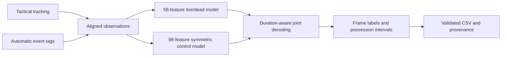

<p align="center">
  
</p>

<p align="center">
  <a href="https://github.com/likalight1/xtension-labs-possessionflow/actions/workflows/ci.yml"></a>
  <a href="requirements-solution.txt"></a>
  <a href="docs/verification.json"></a>
  <a href="models/submission.json"></a>
  <a href="LICENSE"></a>
  
</p>

<p align="center">
  <b>From player tracking to possession spells.</b><br>
  A reproducible football analytics pipeline built by <b>Xtension Labs</b> for More Than A Hack 2027.
</p>

<p align="center">
  <a href="#quick-start">Quick start</a> ·
  <a href="#results">Results</a> ·
  <a href="#how-it-works">How it works</a> ·
  <a href="#submission-artifacts">Submission</a> ·
  <a href="#documentation">Documentation</a>
</p>

## What is PossessionFlow?

PossessionFlow assigns a possession label to every video frame using tactical player and ball tracking plus automatic event tags. A learned live/dead-ball classifier detects stoppages, a symmetric control model identifies the team in possession, and temporal decoding turns noisy observations into coherent possession intervals.

Release **1.3.0** includes the complete **199,319-frame prediction**, reproducible source and frozen model weights. Selected **camera-context** and refitted its control head on all seven public matches.

- **Camera-aware training:** moving field-of-view clipping, detector gaps, duplicate and false detections, fragmented player slots.
- **Possession-change evidence:** contested touches, reach, acceleration and directional context.
- **Missing-ball branch:** bounded observation context and coverage-weighted team geometry.
- **Auditable selection:** fixed ablations, whole-match folds, explicit regression gates and baseline fallback.
- **Portable reproduction:** CPU-only inference, pinned dependencies, hashes and clean-source verification.

## Quick start

Use **Python 3.12**. The verified release environment used CPython 3.12.14.

```bash
git clone https://github.com/likalight1/xtension-labs-possessionflow.git
cd xtension-labs-possessionflow
python -m venv .venv
```

Activate with `source .venv/bin/activate` on Linux/macOS or `.\.venv\Scripts\Activate.ps1` in Windows PowerShell, then:

```bash
python -m pip install -r requirements-solution.txt
python -m unittest discover -s tests -v
python -m possession demo
```

The demo uses synthetic data. To reproduce the competition prediction, obtain the authorized challenge assets and place these three files under `data/tactical/`:

```text
data/tactical/
  BAR-ATH_tactical_atd.xml
  BAR-ATH_tactical_atd.txt
  BAR-ATH_tactical_smart_tagging.xml
```

```bash
python -m possession doctor --data-dir data
python -m possession predict --data-dir data --config configs/default.json --model models/submission.json --out runs/xtension-labs
python -m possession validate runs/xtension-labs/predictions.csv
python -m possession bundle --run-dir runs/xtension-labs --team-name "Xtension Labs" --out dist/xtension-labs
```

Windows users can also run `./run-challenge.ps1 -Action Predict`; pass `-PythonPath` to select your interpreter. See [SOLUTION.md](SOLUTION.md) for options and reproduction details. Restricted match assets and raw external training data are excluded from this repository.

## Results

The latest campaign compared four alternatives with v1.2 across five scored matches and three tracking conditions. **All seven available matches were previously exposed: these are development CV results, not an untouched test or leaderboard score.** Each control fit excludes its scored match fold.

| Candidate | Mean spell F1 | Transition recall | <2s spell recall | Gate |
| --- | ---: | ---: | ---: | --- |
| release-1.2 | 0.4409 | 0.2976 | 0.0861 | baseline |
| camera-context | 0.4776 | 0.3735 | 0.1434 | pass |
| camera-context-fast | 0.4507 | 0.4281 | 0.1793 | fail |
| camera-control | 0.4442 | 0.3092 | 0.0882 | fail |
| context-control | 0.4746 | 0.3972 | 0.1600 | pass |

Selected **camera-context** and refitted its control head on all seven public matches.

See [the protocol and full outcome](docs/ROBUST_CAMPAIGN.md) and [machine-readable evidence](models/robust-selection.json). The historical v1.2 campaign improved mean spell F1 from **0.3670 to 0.4419** on its then-fresh final matches; those matches are now exposed. Its [original evidence](docs/CONTROL_CAMPAIGN.md) and [source archive](models/baselines/v1.2-source.zip) remain preserved.

## How it works



The pipeline separates match halves, checks physical scaling, handles missing observations, and validates model feature schemas. Reference labels enter training and evaluation only. Omitting `--model` explicitly runs the original heuristic baseline; `--tracking-only` disables automatic tactical tags.

To reproduce the external training campaign:

```bash
python tools/train_robust.py --data-dir data/external/idsse --out runs/campaign-reproduction
```

Obtain the seven public IDSSE/Sportec filesets (approximately 2.62 GB) first. Training is an optional research step; inference uses the packaged weights. The [campaign protocol](docs/ROBUST_CAMPAIGN.md) records whole-match folds, camera augmentation, selection and release gates. All results are development CV.

## Submission artifacts

| Artifact | Purpose |
| :--- | :--- |
| [Xtension Labs.csv](submission/Xtension%20Labs.csv) | Validated prediction for all 199,319 video frames |
| [Xtension Labs.md](submission/Xtension%20Labs.md) | Technical submission document |
| [models/submission.json](models/submission.json) | Frozen selected model and training provenance |
| [models/robust-selection.json](models/robust-selection.json) | Current development CV and selection evidence |
| [submission/manifest.json](submission/manifest.json) | Input, code, model, configuration, and output hashes |
| [submission/verification.json](submission/verification.json) | Recorded release checks and development-CV status |

CSV SHA-256:

```text
d00ec38ac1980eca8631e5ce96eb669625ca19999d2e951582969d99a3c81271
```

Check the committed release without downloading any match data:

```bash
python tools/verify_release.py
python -m possession validate "submission/Xtension Labs.csv"
```

**Repository status:** private, as requested by Xtension Labs. The files are prepared; the organizer's submission form has not been submitted. The challenge requires a public source URL for final submission, so the repository's current private visibility does not yet satisfy that requirement. See [SUBMISSION.md](SUBMISSION.md) for the official process.

## Documentation

| Guide | What you will find |
| :--- | :--- |
| [Solution guide](SOLUTION.md) | CLI usage, reproduction, training and packaging |
| [Technical report](docs/TECHNICAL_REPORT.md) | Features, model, decoding, assumptions and limitations |
| [Training campaign](docs/ROBUST_CAMPAIGN.md) | Camera/context ablations and development-CV results |
| [Historical v1.2 review](docs/REVIEW_V2.md) | Earlier checks and remaining weaknesses |
| [Algorithm audit](docs/ALGORITHM_AUDIT.md) | Engineering findings and validation coverage |
| [Challenge](CHALLENGE.md) · [Evaluation](EVALUATION.md) | Organizer task definition and scoring |
| [Data terms](DATA.md) · [Rules](RULES.md) | Authorized data use and competition requirements |
| [Brand attribution](assets/branding/README.md) | Organizer identities, official logo sources and trademark scope |

## Development

Core inference lives in `possession/`, research commands in `tools/`, and the organizer's evaluator in `evaluation/`. Tests exercise parsing, alignment, leakage prevention, deterministic training, temporal decoding, release gates, and packaging.

Run `python -m unittest discover -s tests -v` before changing the pipeline. CI runs on Linux and Windows and validates the committed submission, campaign provenance, and checksums. Changes to inference code require regenerated predictions and provenance; the release verification intentionally detects stale outputs. Git preserves source bytes so the recorded code hash remains stable across clones.

## Credits and license

Built by **Xtension Labs** for [More Than A Hack 2027](https://github.com/metrica-sports/more-than-a-hack-2027), organized by **Metrica Sports**, **FC Barcelona through Barça Innovation Hub**, and **Mobile World Capital Barcelona**, at **Talent Arena**. Organizer identities are confirmed by the [official event page](https://landing.mobileworldcapital.com/more-than-a-hack-2027). The banner credits the event organizers; it does not imply sponsorship or endorsement of Xtension Labs. Talent Arena is credited in text.

External training data: Bassek, Rein, Weber and Memmert (2025), [IDSSE/Sportec dataset](https://doi.org/10.6084/m9.figshare.28196177), **CC BY 4.0**. Preserve this attribution when using the derived trained model; see the technical report for provenance and transformations.

Source code and original challenge materials retain the [MIT license](LICENSE). Organizer logos and trademarks remain the property of their respective owners and are excluded from the code license. Restricted competition assets are governed separately by the organizer's terms.
