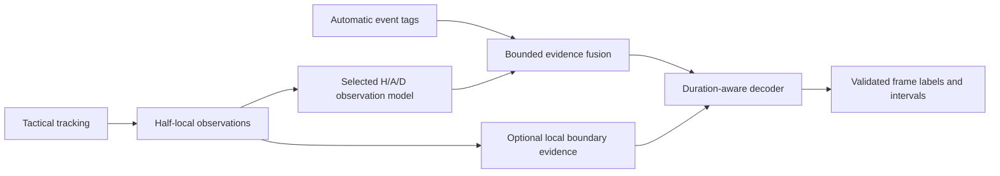

<p align="center">
  
</p>

<p align="center">
  <a href="https://github.com/likalight/xtension-labs-possessionflow/actions/workflows/ci.yml"></a>
  <a href="requirements-solution.txt"></a>
  <a href="docs/verification.json"></a>
  <a href="models/submission.json"></a>
  <a href="LICENSE"></a>
  
</p>

<p align="center">
  <b>From player tracking to possession spells.</b><br>
  A reproducible football analytics pipeline built by <b>Xtension Labs</b> for More Than A Hack 2027.
</p>

<p align="center">
  <a href="#quick-start">Quick start</a> ·
  <a href="#results">Results</a> ·
  <a href="#how-it-works">How it works</a> ·
  <a href="#submission-artifacts">Submission</a> ·
  <a href="#documentation">Documentation</a>
</p>

## What is PossessionFlow?

PossessionFlow assigns H/A/D/X to every football video frame from automatic tactical tracking and event tags. Learned observation models and duration-aware decoding recover complete possession intervals.

Release **1.5.0** contains the validated **199,319-frame prediction**, frozen weights, reproducible inference source and the completed v5 research evidence. Promoted **joint-state** after both the fixed development and fresh-match gates passed.

- **Joint possession/stoppage learning:** a team-symmetric temporal residual trained with a three-class H/A/D objective and positive dead-ball weights.
- **Short-possession boundaries:** observation-only evidence can lower H/A switch penalties locally, with bounded changes and unchanged minimum durations.
- **Fresh-match testing:** one Metrica game and two SkillCorner games, with reference limitations reported explicitly.
- **Auditable release:** fixed gates, historical out-of-fold comparators, exact fallback weights and source/model/output hashes.

The joint H/A/D residual is active in the deployed model. The learned local H/A boundary costs are implemented and evaluated, but inactive. Video recovery and broadcast fusion remain inactive.

## Quick start

Use Python 3.12. Inference runs offline on CPU with no GPU, API key or retraining.

```bash
git clone https://github.com/likalight/xtension-labs-possessionflow.git
cd xtension-labs-possessionflow
python -m venv .venv
```

Activate with `source .venv/bin/activate` on Linux/macOS or `.\.venv\Scripts\Activate.ps1` on Windows, then install `requirements-solution.txt`. `python -m possession demo` uses synthetic data.

For the real prediction, place authorized `BAR-ATH_tactical_atd.xml`, `BAR-ATH_tactical_atd.txt` and `BAR-ATH_tactical_smart_tagging.xml` under `data/tactical/`:

```bash
python -m pip install -r requirements-solution.txt
python -m unittest discover -s tests -v
python -m possession predict --data-dir data --config configs/default.json --model models/submission.json --out runs/reproduction
python -m possession validate runs/reproduction/predictions.csv
```

See [SOLUTION.md](SOLUTION.md) for input checks, Windows launcher options, packaging and optional research prerequisites. Restricted footage, tracking, raw provider samples, camera profiles and feature caches stay local.

## Results

The v5 experiment compares three alternatives with v1.4 in **80 evaluations**: five scored matches, four observation conditions and four candidates. All seven Sportec matches were previously exposed. **These are whole-match development folds, not a fresh test or hidden competition score.** Each comparator uses the historical out-of-fold model.

| Candidate | Spell F1: original 3 conditions | Spell F1: all 4 | Turnover recall: all 4 | <2s recall: all 4 | Development gate |
| --- | ---: | ---: | ---: | ---: | --- |
| joint-state | 0.6233 | 0.6076 | 0.5003 | 0.2784 | pass |
| joint-boundary | 0.6205 | 0.6054 | 0.5168 | 0.3035 | pass |
| baseline-v1.4 | 0.5767 | 0.5596 | 0.4661 | 0.2237 | incumbent |
| boundary | 0.5767 | 0.5604 | 0.4864 | 0.2534 | fail |

Development selection: **joint-state**. Frozen audit candidate: **joint-state**. If no new candidate passes the development gate, the highest-ranked experiment is still audited to answer the fresh-match research question, but remains ineligible for promotion. The audit candidate is fixed before any final reference access.

One frozen candidate, **joint-state**, was evaluated against v1.4 on three matches not used for training or candidate tuning. The fresh-match gate **passed**. Metrica Game 3 balanced team recall was **86.91% → 90.03%**. All increases and declines are shown below; a successful audit alone cannot override a failed development gate.

| Fresh match and reference type | Scored points | v1.4 team accuracy | Candidate team accuracy | Change (percentage points) |
| --- | ---: | ---: | ---: | ---: |
| Metrica Game 3: sparse provider pass events | 1,467 | 86.98% | 90.12% | +3.14 |
| SkillCorner 1886347: automatic phase labels | 31,988 | 84.61% | 86.34% | +1.73 |
| SkillCorner 1899585: automatic phase labels | 29,514 | 81.06% | 82.18% | +1.12 |

Metrica Game 3 supplies sparse pass-origin labels from provider events; the annotation method is unverified, so these are not described as human ground truth. SkillCorner supplies dense H/A labels only inside its automatic phase intervals. Unlabelled gaps remain X and are never interpreted as dead ball. D/X predictions at known H/A points count as errors. These checks do not establish fresh human-labelled dense H/A/D accuracy, possession-spell F1 or stoppage recall. The three audit matches are now exposed and cannot be reused as untouched tuning targets.

Promoted **joint-state** after both the fixed development gates and the one-shot three-match fresh audit passed.

See the [full v5 protocol and outcome](docs/JOINT_CAMPAIGN.md), [development evidence](models/joint-selection.json) and [fresh audit](models/fresh-audit.json). Historical [v1.4 evidence](docs/MULTIMODAL_CAMPAIGN.md) remains preserved.

## How it works



Deployed model: **joint-state**. The joint H/A/D residual is active in the deployed model. The learned local H/A boundary costs are implemented and evaluated, but inactive. Omitting `--model` explicitly runs the original heuristic; `--tracking-only` disables automatic tags. Implementing an experiment does not imply it improved the submitted prediction.

## Submission artifacts

| Artifact | Purpose |
| :--- | :--- |
| [Xtension Labs.csv](submission/Xtension%20Labs.csv) | Validated prediction for 199,319 frames |
| [Xtension Labs.md](submission/Xtension%20Labs.md) | Technical submission document |
| [Production model](models/submission.json) | Frozen deployed weights |
| [V5 evidence](models/joint-selection.json) | Development comparison and release decision |
| [Fresh audit](models/fresh-audit.json) | Provider-level scores, limits and fixed gate |
| [Manifest](submission/manifest.json) | Input, source, configuration, model and output hashes |
| [Verification](submission/verification.json) | Completed release checks |

CSV SHA-256: `1ddbe062fb0ff0bbb2f47fccda472953fee399629b3b88af9b23554b5f7a3ceb`

```bash
python tools/verify_release.py
python -m possession validate "submission/Xtension Labs.csv"
```

The repository remains private under `likalight`, as requested. Prepared files are not a submitted competition form. The organizer's public-source requirement, emailed form and team eligibility remain outstanding. Hidden competition scores, ranking and winning probability are unknown. See [SUBMISSION.md](SUBMISSION.md).

## Documentation

| Guide | Contents |
| :--- | :--- |
| [Solution](SOLUTION.md) | Reproduction and optional campaign prerequisites |
| [Technical report](docs/TECHNICAL_REPORT.md) | Method, provenance and limits |
| [V5 campaign](docs/JOINT_CAMPAIGN.md) | Joint-state and boundary experiments |
| [V4 campaign](docs/MULTIMODAL_CAMPAIGN.md) | Historical temporal-control evidence |
| [Independent data](docs/INDEPENDENT_DATA.md) | Earlier sparse audits and data limitations |
| [Video recovery](docs/VIDEO_RECOVERY.md) | Inactive video research |
| [Brand attribution](assets/branding/README.md) | Organizer identities and trademark scope |

## Development

Core inference is in `possession/`, optional research in `tools/`, and the official scorer in `evaluation/`. The research environment passed **230 engineering tests**. Minimal installations may skip optional Torch/vision tests; recorded environment-specific counts are in the verification report. CI checks Linux and Windows release integrity. Scientific source changes require regenerated evidence.

## Credits and license


Built by **Xtension Labs** for [More Than A Hack 2027](https://github.com/metrica-sports/more-than-a-hack-2027), organized by **Metrica Sports**, **FC Barcelona through Barça Innovation Hub**, and **Mobile World Capital Barcelona**, at **Talent Arena**. Organizer identities are confirmed by the [official event page](https://landing.mobileworldcapital.com/more-than-a-hack-2027). The banner credits the event organizers; it does not imply sponsorship or endorsement of Xtension Labs. Talent Arena is credited in text.

External training data: Bassek, Rein, Weber and Memmert (2025), [IDSSE/Sportec dataset](https://doi.org/10.6084/m9.figshare.28196177), **CC BY 4.0**. Preserve this attribution when using the derived trained model; see the technical report for provenance and transformations.

Source code and original challenge materials retain the [MIT license](LICENSE). Organizer logos and trademarks remain the property of their respective owners and are excluded from the code license. Restricted competition assets are governed separately by the organizer's terms.

Optional Ultralytics video research has separate AGPL-3.0 terms. Its code and weights are not required for inference; detector weights and raw imagery are not redistributed. Metrica sample tracking/event data is credited in [the independent-data report](docs/INDEPENDENT_DATA.md).

Fresh evaluation additionally uses [Metrica sample data](https://github.com/metrica-sports/sample-data) and [SkillCorner open data](https://github.com/SkillCorner/opendata). See the providers' terms and the pinned download provenance; raw samples are not redistributed and were not used to train these candidates.
