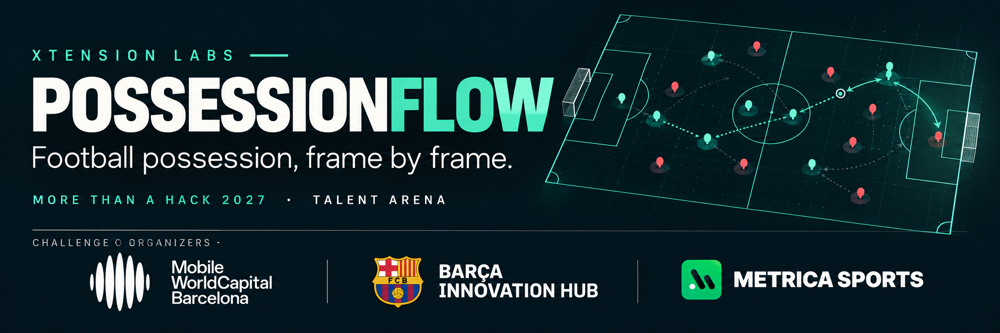
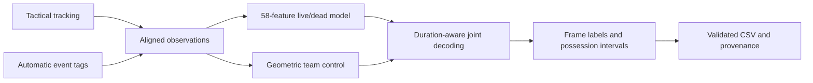

<p align="center">
  
</p>

<p align="center">
  <a href="https://github.com/likalight1/xtension-labs-possessionflow/actions/workflows/ci.yml"></a>
  <a href="requirements-solution.txt"></a>
  <a href="docs/verification.json"></a>
  <a href="models/submission.json"></a>
  <a href="LICENSE"></a>
  
</p>

<p align="center">
  <b>From player tracking to possession spells.</b><br>
  A reproducible football analytics pipeline built by <b>Xtension Labs</b> for More Than A Hack 2027.
</p>

<p align="center">
  <a href="#quick-start">Quick start</a> ·
  <a href="#results">Results</a> ·
  <a href="#how-it-works">How it works</a> ·
  <a href="#submission-artifacts">Submission</a> ·
  <a href="#documentation">Documentation</a>
</p>

## What is PossessionFlow?

PossessionFlow assigns a possession label to every video frame using tactical player and ball tracking plus automatic event tags. A learned live/dead-ball classifier detects stoppages, geometry estimates team control, and temporal decoding turns noisy observations into coherent possession intervals.

The selected **`l2-0.001_joint`** model is included. Inference runs locally on a CPU with no API keys or retraining. The release contains the complete **199,319-frame BAR–ATH prediction**, its provenance, and the evidence behind model selection.

- **Learned stoppages:** 58 features trained on two external matches, with separate validation and final-test matches.
- **Temporal consistency:** duration-aware Viterbi decoding combines stoppages and team control.
- **Reproducibility:** frozen weights, pinned dependencies, input/output hashes, and a verified byte-identical clean-source reproduction.
- **Auditable evaluation:** clean and degraded tracking benchmarks, leakage checks, and explicit release gates.
- **Portable delivery:** Python CLI, Windows launcher, synthetic demo, and dataset-free CI.

## Quick start

Use **Python 3.12**. The verified release environment used CPython 3.12.14.

```bash
git clone https://github.com/likalight1/xtension-labs-possessionflow.git
cd xtension-labs-possessionflow
python -m venv .venv
```

Activate with `source .venv/bin/activate` on Linux/macOS or `.\.venv\Scripts\Activate.ps1` in Windows PowerShell, then:

```bash
python -m pip install -r requirements-solution.txt
python -m unittest discover -s tests -v
python -m possession demo
```

The demo uses synthetic data. To reproduce the competition prediction, obtain the authorized challenge assets and place these three files under `data/tactical/`:

```text
data/tactical/
  BAR-ATH_tactical_atd.xml
  BAR-ATH_tactical_atd.txt
  BAR-ATH_tactical_smart_tagging.xml
```

```bash
python -m possession doctor --data-dir data
python -m possession predict --data-dir data --config configs/default.json --model models/submission.json --out runs/xtension-labs
python -m possession validate runs/xtension-labs/predictions.csv
python -m possession bundle --run-dir runs/xtension-labs --team-name "Xtension Labs" --out dist/xtension-labs
```

Windows users can also run `./run-challenge.ps1 -Action Predict`; pass `-PythonPath` to select your interpreter. See [SOLUTION.md](SOLUTION.md) for options and reproduction details. Restricted match assets and raw external training data are excluded from this repository.

## Results

The model was trained on **J03WOH + J03WOY**, selected on **J03WN1**, and then evaluated on untouched **J03WMX**. Six learned candidates were compared against the heuristic baseline. Competition public labels were not used for training or model selection.

| Untouched final test | Baseline spell F1 | PossessionFlow spell F1 | Baseline macro F1 | PossessionFlow macro F1 | Dead-ball recall, before → after |
| :--- | ---: | ---: | ---: | ---: | ---: |
| Clean tracking | 0.3557 | **0.3938** | 0.7199 | **0.8550** | 0.5520 → **0.9663** |
| Degraded tracking | 0.1877 | **0.2581** | 0.5969 | **0.7772** | 0.3723 → **0.9535** |

Mean spell-F1 gain was **+0.0543**, passing the predeclared release gate. Higher stoppage recall comes with lower dead-ball precision: **0.9164** on clean and **0.8591** on degraded tracking. Control transitions remain a limitation: the selected model predicts 258/256 possession spells against 511 reference spells.

These are external-match results, not a hackathon leaderboard score. The hidden competition score is unknown. See the [training campaign](docs/TRAINING_CAMPAIGN.md), [independent model review](docs/MODEL_REVIEW.md), and [machine-readable verification](docs/verification.json).

## How it works



The pipeline separates match halves, checks physical scaling, handles missing observations, and validates model feature schemas. Reference labels enter training and evaluation only. Omitting `--model` explicitly runs the original heuristic baseline; `--tracking-only` disables automatic tactical tags.

To reproduce the external training campaign:

```bash
python tools/train_stoppages.py --download --out runs/campaign-reproduction
```

This downloads approximately 1.52 GB of external match data. It is an optional research step; inference uses the packaged weights. The [experiment protocol](docs/EXPERIMENT_PROTOCOL.md) records match separation, degradation, selection, and release gates.

## Submission artifacts

| Artifact | Purpose |
| :--- | :--- |
| [Xtension Labs.csv](submission/Xtension%20Labs.csv) | Validated prediction for all 199,319 video frames |
| [Xtension Labs.md](submission/Xtension%20Labs.md) | Technical submission document |
| [models/submission.json](models/submission.json) | Frozen selected model and training provenance |
| [models/selection.json](models/selection.json) | Candidate selection evidence |
| [submission/manifest.json](submission/manifest.json) | Input, code, model, configuration, and output hashes |
| [submission/verification.json](submission/verification.json) | Recorded release checks and final-test results |

CSV SHA-256:

```text
ea2807bbe4b15d25f1d1ec4494fea42a85bee215f2d1f43a417642d5bd60ac96
```

Check the committed release without downloading any match data:

```bash
python tools/verify_release.py
python -m possession validate "submission/Xtension Labs.csv"
```

**Repository status:** private, as requested by Xtension Labs. The files are prepared; the organizer's submission form has not been submitted. The challenge requires a public source URL for final submission, so the repository's current private visibility does not yet satisfy that requirement. See [SUBMISSION.md](SUBMISSION.md) for the official process.

## Documentation

| Guide | What you will find |
| :--- | :--- |
| [Solution guide](SOLUTION.md) | CLI usage, reproduction, training and packaging |
| [Technical report](docs/TECHNICAL_REPORT.md) | Features, model, decoding, assumptions and limitations |
| [Training campaign](docs/TRAINING_CAMPAIGN.md) | Candidate comparisons and external final-test results |
| [Model review](docs/MODEL_REVIEW.md) | Independent checks and remaining weaknesses |
| [Algorithm audit](docs/ALGORITHM_AUDIT.md) | Engineering findings and validation coverage |
| [Challenge](CHALLENGE.md) · [Evaluation](EVALUATION.md) | Organizer task definition and scoring |
| [Data terms](DATA.md) · [Rules](RULES.md) | Authorized data use and competition requirements |
| [Brand attribution](assets/branding/README.md) | Organizer identities, official logo sources and trademark scope |

## Development

Core inference lives in `possession/`, research commands in `tools/`, and the organizer's evaluator in `evaluation/`. Tests exercise parsing, alignment, leakage prevention, deterministic training, temporal decoding, release gates, and packaging.

Run `python -m unittest discover -s tests -v` before changing the pipeline. CI also validates the committed submission and its checksums. Changes to inference code require regenerated predictions and provenance; the release verification intentionally detects stale outputs. Git preserves source bytes so the recorded code hash remains stable across clones.

## Credits and license

Built by **Xtension Labs** for [More Than A Hack 2027](https://github.com/metrica-sports/more-than-a-hack-2027), organized by **Metrica Sports**, **FC Barcelona through Barça Innovation Hub**, and **Mobile World Capital Barcelona**, at **Talent Arena**. Organizer identities are confirmed by the [official event page](https://landing.mobileworldcapital.com/more-than-a-hack-2027). The banner credits the event organizers; it does not imply sponsorship or endorsement of Xtension Labs. Talent Arena is credited in text.

External training data: Bassek, Rein, Weber and Memmert (2025), [IDSSE/Sportec dataset](https://doi.org/10.6084/m9.figshare.28196177), **CC BY 4.0**. Preserve this attribution when using the derived trained model; see the technical report for provenance and transformations.

Source code and original challenge materials retain the [MIT license](LICENSE). Organizer logos and trademarks remain the property of their respective owners and are excluded from the code license. Restricted competition assets are governed separately by the organizer's terms.
