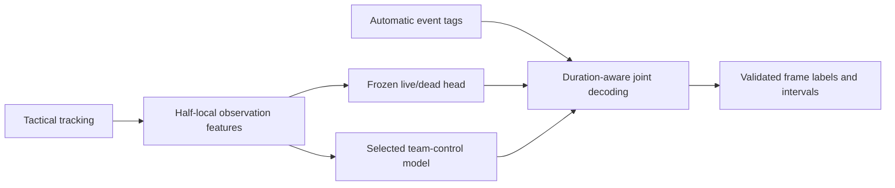

<p align="center">
  
</p>

<p align="center">
  <a href="https://github.com/likalight/xtension-labs-possessionflow/actions/workflows/ci.yml"></a>
  <a href="requirements-solution.txt"></a>
  <a href="docs/verification.json"></a>
  <a href="models/submission.json"></a>
  <a href="LICENSE"></a>
  
</p>

<p align="center">
  <b>From player tracking to possession spells.</b><br>
  A reproducible football analytics pipeline built by <b>Xtension Labs</b> for More Than A Hack 2027.
</p>

<p align="center">
  <a href="#quick-start">Quick start</a> ·
  <a href="#results">Results</a> ·
  <a href="#how-it-works">How it works</a> ·
  <a href="#submission-artifacts">Submission</a> ·
  <a href="#documentation">Documentation</a>
</p>

## What is PossessionFlow?

PossessionFlow assigns H/A/D/X to every video frame using tactical tracking and automatic event tags. It combines learned live/dead and team-control evidence with duration-aware decoding to recover complete possessions.

Release **1.4.0** contains a **199,319-frame prediction**, model weights and reproducible inference source. Promoted **gated-temporal** after the fixed development gates and separate sparse audit.

- **Production:** frozen live/dead head, 98-feature symmetric control model, possession-change evidence, missing-ball context and duration-aware decoding.
- **Calibrated training experiment:** eight aggregate camera footprints and visibility statistics derived without target possession labels.
- **Temporal experiment:** a team-symmetric convolutional residual at 5 Hz, with independent match halves and CPU NumPy inference.
- **Learned combination experiment:** an observation-reliability gate trained on an inner held-out match.
- **Video research:** local ball recovery and broadcast-alignment pilots; both remain inactive after failing their evidence requirements.

The temporal residual is active in the deployed model. The learned reliability gate is active. Implemented experiments are not evidence of improved competition accuracy.

## Quick start

Use Python 3.12. Inference runs offline on CPU with no API key or retraining.

```bash
git clone https://github.com/likalight/xtension-labs-possessionflow.git
cd xtension-labs-possessionflow
python -m venv .venv
```

Activate with `source .venv/bin/activate` on Linux/macOS or `.\.venv\Scripts\Activate.ps1` in Windows PowerShell, then:

```bash
python -m pip install -r requirements-solution.txt
python -m unittest discover -s tests -v
python -m possession demo
```

The demo uses synthetic data. For the real prediction, place the authorized `BAR-ATH_tactical_atd.xml`, `BAR-ATH_tactical_atd.txt` and `BAR-ATH_tactical_smart_tagging.xml` under `data/tactical/`, then:

```bash
python -m possession doctor --data-dir data
python -m possession predict --data-dir data --config configs/default.json --model models/submission.json --out runs/xtension-labs
python -m possession validate runs/xtension-labs/predictions.csv
python -m possession bundle --run-dir runs/xtension-labs --team-name "Xtension Labs" --out dist/xtension-labs
```

See [SOLUTION.md](SOLUTION.md) for Windows launcher options, optional research dependencies and training prerequisites. Restricted match assets, raw external data, camera profiles and feature caches are excluded.

## Results

The v4 campaign compares three candidates with v1.3 in **20 whole-match/condition cells each** (80 evaluations). Five matches are scored across three folds. All seven Sportec matches were exposed earlier: **these are development CV results, not a fresh test or leaderboard score**. Each comparison uses the incumbent's out-of-fold head rather than scoring its all-seven refit on training matches.

| Candidate | Spell F1: original 3 conditions | Spell F1: all 4 conditions | Transition recall: all 4 | <2s recall: all 4 | Development gate |
| --- | ---: | ---: | ---: | ---: | --- |
| gated-temporal | 0.5767 | 0.5596 | 0.4661 | 0.2237 | pass |
| temporal | 0.5742 | 0.5579 | 0.4840 | 0.2355 | pass |
| baseline-v1.3 | 0.4776 | 0.4676 | 0.3582 | 0.1368 | incumbent |
| calibrated-control | 0.4752 | 0.4656 | 0.3689 | 0.1427 | fail |

The original three conditions determine ranking. The additional target-calibrated condition must also satisfy the regression limits. Development selection: **gated-temporal**. Deployed model: **gated-temporal**.

Promoted **gated-temporal** after the fixed development gates and separate sparse audit. Promoted gated-temporal after passing the fixed development gates and one-shot sparse independent audit.

The single frozen candidate was compared with v1.3 on 964 unique Game 2 pass origins. Exact team accuracy: baseline **88.59%**, candidate **87.66%**; balanced team recall: **88.43%** and **87.60%**. The predeclared sparse-audit gate passed. D/X predictions count as errors. This audit cannot measure dense spell F1 or stoppage recall. Game 2 has now been consumed and must not be reused as an untouched tuning target.

The separate Game 1 adapter-development audit of v1.3 scored **89.10% exact team accuracy on 798 pass origins**. It predicted dead ball at 53 of them. This is a sparse diagnostic, not a dense possession score. [Independent-data details](docs/INDEPENDENT_DATA.md).

See the [v4 protocol and results](docs/MULTIMODAL_CAMPAIGN.md), [machine-readable selection](models/multimodal-selection.json), and preserved [v1.3 evidence](docs/ROBUST_CAMPAIGN.md).

## How it works



The temporal residual is active in the deployed model. The learned reliability gate is active. Video recovery and broadcast fusion are inactive. Their pilot results do not justify altering the production tracking input. Omitting `--model` explicitly runs the original heuristic; `--tracking-only` disables automatic tags.

## Submission artifacts

| Artifact | Purpose |
| :--- | :--- |
| [Xtension Labs.csv](submission/Xtension%20Labs.csv) | Validated prediction for 199,319 frames |
| [Xtension Labs.md](submission/Xtension%20Labs.md) | Technical submission document |
| [Model](models/submission.json) | Frozen production weights |
| [V4 evidence](models/multimodal-selection.json) | Fixed development comparison and release decision |
| [Manifest](submission/manifest.json) | Input, source, model, configuration and output hashes |
| [Verification](submission/verification.json) | Completed release checks and limitations |

CSV SHA-256: `f044c553e8007a3dcffa5931f06f0dcf32beb6453e947b9f5eabdfa594e7827f`

```bash
python tools/verify_release.py
python -m possession validate "submission/Xtension Labs.csv"
```

The repository remains private at the user's request. Prepared files are not a submitted competition form. The organizer's public-source requirement, emailed submission form and team eligibility remain outstanding. Hidden competition scores, ranking and winning probability are unknown. See [SUBMISSION.md](SUBMISSION.md) for the official process.

## Documentation

| Guide | Contents |
| :--- | :--- |
| [Solution](SOLUTION.md) | Inference, packaging and research prerequisites |
| [Technical report](docs/TECHNICAL_REPORT.md) | Method, provenance and limitations |
| [V4 campaign](docs/MULTIMODAL_CAMPAIGN.md) | Calibrated camera, temporal and gate experiments |
| [Independent data](docs/INDEPENDENT_DATA.md) | Sparse metric, split and access limitations |
| [Video recovery](docs/VIDEO_RECOVERY.md) | Rejected pilots and precision requirements |
| [Historical v1.3](docs/ROBUST_CAMPAIGN.md) | Earlier camera/context development evidence |
| [Rules](RULES.md) · [Evaluation](EVALUATION.md) | Organizer requirements and scoring |
| [Brand attribution](assets/branding/README.md) | Official identities, logo sources and trademark scope |

## Development

Core inference is in `possession/`, optional research commands in `tools/`, and the official scorer in `evaluation/`. The research environment passed **181 engineering tests**. Optional vision tests can skip in the minimal core environment; see the release verification for the actual environments and counts. The CI workflow checks Linux and Windows release integrity. Source changes require matching regenerated provenance.

## Credits and license


Built by **Xtension Labs** for [More Than A Hack 2027](https://github.com/metrica-sports/more-than-a-hack-2027), organized by **Metrica Sports**, **FC Barcelona through Barça Innovation Hub**, and **Mobile World Capital Barcelona**, at **Talent Arena**. Organizer identities are confirmed by the [official event page](https://landing.mobileworldcapital.com/more-than-a-hack-2027). The banner credits the event organizers; it does not imply sponsorship or endorsement of Xtension Labs. Talent Arena is credited in text.

External training data: Bassek, Rein, Weber and Memmert (2025), [IDSSE/Sportec dataset](https://doi.org/10.6084/m9.figshare.28196177), **CC BY 4.0**. Preserve this attribution when using the derived trained model; see the technical report for provenance and transformations.

Source code and original challenge materials retain the [MIT license](LICENSE). Organizer logos and trademarks remain the property of their respective owners and are excluded from the code license. Restricted competition assets are governed separately by the organizer's terms.

Optional Ultralytics video research has separate AGPL-3.0 terms. Its code and weights are not required for inference; detector weights and raw imagery are not redistributed. Metrica sample tracking/event data is credited in [the independent-data report](docs/INDEPENDENT_DATA.md).
